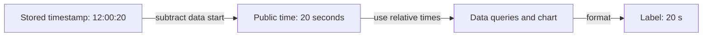
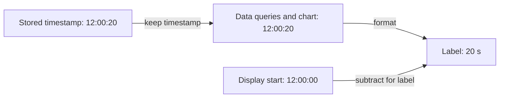

# Keep real timestamps when showing relative time

[PR #20229](https://github.com/nominal-io/galaxy/pull/20229) makes relative time a display choice.

The workbook keeps real timestamps throughout. A chart can show “20 s after the start” without changing the time used to fetch data, place an event or seek a video.

## Why this change exists

Switching between clock time and relative time should keep you on the same moment.

Before this PR, different parts of the workbook handled that switch themselves. Some passed real timestamps. Others passed seconds from the start. Mixing the two could move a chart or event to the wrong time.

## Before

- The range store already saved real timestamps internally.
- In relative mode, its public API returned times measured from the data start.
- Data queries and charts used those relative values too.
- Consumers had to convert times when crossing between the two forms.

**Before this PR, in relative mode:**

See the [old time API][range-before] and [old compute context][compute-before].

## After

- Time APIs return and accept real timestamps.
- Data queries, charts, events and playback use those same timestamps.
- The chart subtracts a chosen start time only when making labels.
- Switching display mode no longer changes the query’s times.

**After this PR, in relative mode:**

You can choose that display start by setting **T0**. Otherwise, relative mode uses the data window’s start.

For example:

- The chart shows data from `12:00:10` to `12:00:20`.
- With T0 at `12:00:00`, its labels read `10–20 s`.
- Move T0 to `12:00:15`, and the labels read `−5–5 s`.
- The chart still shows the same data.

See the [new time API][range-after], [request times][request-after] and [label formatting][ticks-after].

## What this means elsewhere

- **Events:** creating or dragging an event uses the chart’s real timestamp directly.
- **Video:** the playhead, video and chart use the same timeline.
- **Selection:** selections already expected real timestamps. The surrounding APIs now agree.
- **Data loading:** a display-only toggle no longer tells compute to reload its context. Actual data or range changes still can.

Real run-alignment offsets still apply. They move data to line up runs. They serve a different purpose from relative labels. See [events][event-writes], [playback][clock-after] and [compute offsets][offsets-after].

## Two details worth knowing before review

**Old chart settings need a repair.**

Charts group samples into time buckets. An anchor sets where those buckets start.

- Some old anchors saved “seconds from the start” as though they were real timestamps.
- The original start time was not saved, so those anchors cannot be recovered reliably.
- For content older than schema `26.2.0`, the migration clears anchors dated before 1 January 2000. Charts then choose a new anchor.
- Bucket size stays the same. Bucket boundaries can move.
- This date-based guess can also clear valid anchors in simulation data near the Unix epoch.

See the [migration][migration-code] and the [author’s explanation][migration-discussion].

**URLs still need conversion in this PR.**

- Runtime T0 is a real timestamp.
- URL and saved T0 can still be relative offsets.
- A relative URL T0 waits until the data start is known before becoming a timestamp.

See [URL loading][url-read] and [the delayed conversion][url-resolve].

## Where to start in the code

1. [TimeRangeStore][range-after]: how times enter and leave the store.
2. [Editor URL handling][url-read]: where relative values still need conversion.
3. [Anchor migration][migration-code]: the main saved-data trade-off.

The follow-ups separate cleanup from this behaviour change:

- [#20233](https://github.com/nominal-io/galaxy/pull/20233) removes duplicate `*Absolute` method names.
- [#20224](https://github.com/nominal-io/galaxy/pull/20224) makes URL T0 absolute.
- [#20244](https://github.com/nominal-io/galaxy/pull/20244) removes unused time-mode parameters from compute.

Those summaries come from the follow-up descriptions. Their code was not analysed here.

## Source snapshot

- Prepared: 29 October 2026, 14:52 UTC. Complete source walkthrough for this PR.
- Scope: 170 files, +2,095 / −3,171 lines.
- Head: `caf60ed5d2a2af5a2057c5b23be54cc2f5879b25`.
- Comparison base: `377bded2d4be26d136a1424cd4bb71092c429e8d`.
- Base branch tip when checked: `29a5d84cbbf3947518b27b0d8d31a4ee0a7b3ee7`.
- Tests were read, not run. Diagrams were not rendered. No browser checks ran.
- Bazel and Meticulous had failing checks in this snapshot. Causes were not investigated. [PR checks](https://github.com/nominal-io/galaxy/pull/20229/checks).

[range-before]: https://github.com/nominal-io/galaxy/blob/377bded2d4be26d136a1424cd4bb71092c429e8d/packages/compute-store/src/stores/time/timeRange.ts#L172-L241
[compute-before]: https://github.com/nominal-io/galaxy/blob/377bded2d4be26d136a1424cd4bb71092c429e8d/packages/compute-store/src/stores/computeContext.ts#L222-L256
[range-after]: https://github.com/nominal-io/galaxy/blob/caf60ed5d2a2af5a2057c5b23be54cc2f5879b25/packages/compute-store/src/stores/time/timeRange.ts#L112-L163
[request-after]: https://github.com/nominal-io/galaxy/blob/caf60ed5d2a2af5a2057c5b23be54cc2f5879b25/apps/scout/src/client/hooks/compute/useLoadSeriesData.ts#L508-L525
[ticks-after]: https://github.com/nominal-io/galaxy/blob/caf60ed5d2a2af5a2057c5b23be54cc2f5879b25/packages/chart/src/component/axes/drawTimeTicks.ts#L146-L177
[offsets-after]: https://github.com/nominal-io/galaxy/blob/caf60ed5d2a2af5a2057c5b23be54cc2f5879b25/packages/compute-store/src/stores/computeContext.ts#L581-L625
[event-writes]: https://github.com/nominal-io/galaxy/blob/caf60ed5d2a2af5a2057c5b23be54cc2f5879b25/packages/workbook-store/src/stores/events/events.ts#L731-L740
[clock-after]: https://github.com/nominal-io/galaxy/blob/caf60ed5d2a2af5a2057c5b23be54cc2f5879b25/packages/workbook-store/src/stores/playbackClock/playbackClock.ts#L258-L269
[url-read]: https://github.com/nominal-io/galaxy/blob/caf60ed5d2a2af5a2057c5b23be54cc2f5879b25/packages/workbook-store/src/stores/editor.ts#L395-L415
[url-resolve]: https://github.com/nominal-io/galaxy/blob/caf60ed5d2a2af5a2057c5b23be54cc2f5879b25/packages/workbook-store/src/stores/editor.ts#L682-L697
[migration-discussion]: https://github.com/nominal-io/galaxy/pull/20229#discussion_r4175002038
[migration-code]: https://github.com/nominal-io/galaxy/blob/caf60ed5d2a2af5a2057c5b23be54cc2f5879b25/packages/workbook-scout-client/src/migrations/dropRelativeAnchorPoints.ts#L8-L35
