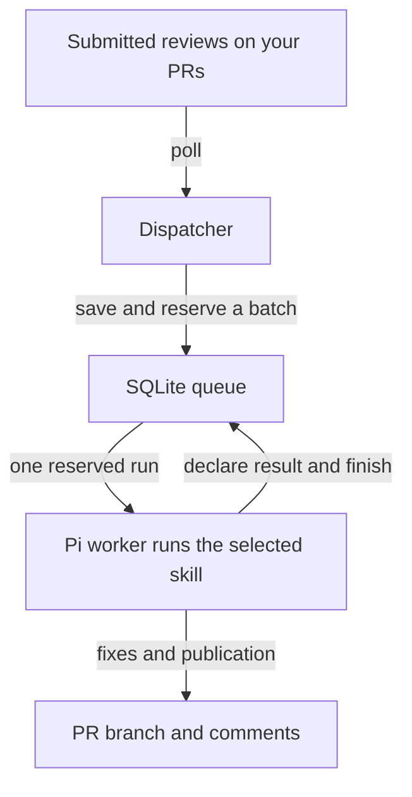

## Architecture walkthrough: handle feedback on your PRs

### Summary

This PR adds an opt-in workflow that runs a skill when someone reviews one of your PRs.

Picco watches for reviews, groups them into a batch and starts one worker. The selected skill decides what to change, runs checks, pushes fixes and posts updates.

### Why

Reviews often arrive in several parts. Starting a worker for each one would repeat setup and could make workers compete over the same branch.

This design waits for a quiet period, then gives one worker a fixed set of reviews. It remembers handled reviews across pushes and restarts.

### Before

- `githubReviews()` runs reviews of other people’s PRs.
- Merged PRs #81 and #82 added discovery and saved queue state for feedback on your own PRs.
- Those feedback pieces were internal. They did not expose a working plugin or start a feedback worker.

This PR connects those pieces and [exports `githubFeedback()`][exports].

### After

**At this PR’s head:**

- By default, Picco checks every minute.
- A PR becomes eligible after ten minutes without a new eligible review, or thirty minutes after the first pending review was discovered.
- Picco rechecks the PR before reserving its batch. Worker availability and API backoff can delay the start.
- Only one feedback worker runs at a time. Its review IDs stay fixed while it works.

For example:

- Two reviews arrive a few minutes apart.
- Picco waits for the quiet period, then starts one worker for both.
- A third review arrives while that worker runs. It waits for a later batch.
- After successful completion, a push or restart does not repeat the first two reviews.

See [the dispatcher][dispatcher] and [batch admission][admission].

### What this means elsewhere

- **Existing review automation:** stays separate. Reviewing someone else’s PR and fixing feedback on your own PR use different queues.
- **Applications:** must register and enable the plugin. It defaults to disabled. This PR does not change a live bot’s configuration.
- **The selected skill:** owns triage, repository checks, commits and GitHub updates. Picco supplies the batch, session and saved paths.
- **Notifications:** use a shared callback helper. A notification failure does not repeat completed feedback work.

### Details worth knowing

**Saying “done” is not enough.**

- The worker must call its session-only `github_feedback_complete` tool.
- The runner attempts session cleanup before recording the final outcome.
- The declaration records what the worker reports. It does not independently prove a push or comment succeeded.

**Uncertain work waits for a decision.**

- Failed or interrupted attempts block further work on that PR.
- An operator inspects saved files and GitHub before marking the batch complete or allowing a retry.
- A retry keeps the original batch and artifact directory, so it can repair missing publication without repeating fixes.
- If worker cleanup cannot be confirmed, new feedback work pauses across the plugin.

See [completion and cleanup][completion] and [the recovery guide][guide]. Ordinary PR comments and thread replies do not trigger this workflow; submitted reviews do.

### Important changed files

These are the main groups, rather than every changed file:

- **Coordinate work:** [`feedback.ts`][dispatcher] polls GitHub, updates the queue and starts one worker.
- **Run the skill:** [`feedback-runner.ts`][runner] manages the session, completion evidence and final outcome.
- **Share notification handling:** [`callback.ts`][callback] and [`runner.ts`][review-runner] give both workflows the same callback deadline.
- **Expose and explain setup:** [`index.ts`][exports] exports the factory; [`github-feedback.md`][guide] explains enablement and recovery.
- **Check the lifecycle:** [`feedback.test.ts`][dispatcher-tests], [`feedback-runner.test.ts`][runner-tests] and the [integration test][integration] cover batching, completion, failures and restart behaviour.

### Where to start

1. Read the dispatcher’s `poll` and `startNextWorker` functions to follow a review into a reserved batch.
2. Read the runner’s `execute` and completion tool to understand when a run counts as handled.
3. Read the recovery guide to understand what happens after an uncertain attempt.

### Source snapshot

- Prepared: 29 October 2026, 15:45 UTC. Complete source walkthrough for #83. Base and head rechecked before posting.
- Head: `fdd25786205b05ea93c9851a166d43f76cce32ef`.
- Base and merge-base: `f26786073a9ea0ef47de4f40bb9d998b3fdbb2a5`.
- Scope: 15 changed files, +1,433 / −26 lines.
- Tests were read, not run. The integration uses fake GitHub and model services; live pushes and publication were not exercised by that test.
- Diagram rendering was not checked. This brief explains the design and does not approve the implementation.

[exports]: https://github.com/anthonyshort/picco/blob/fdd25786205b05ea93c9851a166d43f76cce32ef/packages/plugin-github-reviews/src/index.ts#L427-L434
[dispatcher]: https://github.com/anthonyshort/picco/blob/fdd25786205b05ea93c9851a166d43f76cce32ef/packages/plugin-github-reviews/src/feedback.ts#L95-L225
[admission]: https://github.com/anthonyshort/picco/blob/fdd25786205b05ea93c9851a166d43f76cce32ef/packages/plugin-github-reviews/src/feedback-store.ts#L293-L337
[completion]: https://github.com/anthonyshort/picco/blob/fdd25786205b05ea93c9851a166d43f76cce32ef/packages/plugin-github-reviews/src/feedback-runner.ts#L66-L93
[guide]: https://github.com/anthonyshort/picco/blob/fdd25786205b05ea93c9851a166d43f76cce32ef/docs/guides/github-feedback.md
[runner]: https://github.com/anthonyshort/picco/blob/fdd25786205b05ea93c9851a166d43f76cce32ef/packages/plugin-github-reviews/src/feedback-runner.ts
[callback]: https://github.com/anthonyshort/picco/blob/fdd25786205b05ea93c9851a166d43f76cce32ef/packages/plugin-github-reviews/src/callback.ts
[review-runner]: https://github.com/anthonyshort/picco/blob/fdd25786205b05ea93c9851a166d43f76cce32ef/packages/plugin-github-reviews/src/runner.ts
[dispatcher-tests]: https://github.com/anthonyshort/picco/blob/fdd25786205b05ea93c9851a166d43f76cce32ef/packages/plugin-github-reviews/src/feedback.test.ts
[runner-tests]: https://github.com/anthonyshort/picco/blob/fdd25786205b05ea93c9851a166d43f76cce32ef/packages/plugin-github-reviews/src/feedback-runner.test.ts
[integration]: https://github.com/anthonyshort/picco/blob/fdd25786205b05ea93c9851a166d43f76cce32ef/integration/src/github-feedback.test.ts#L135-L169
